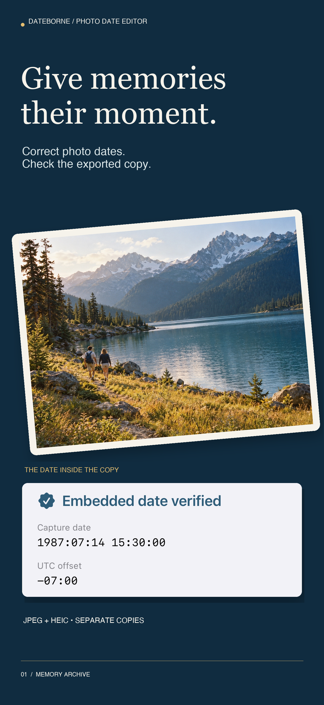
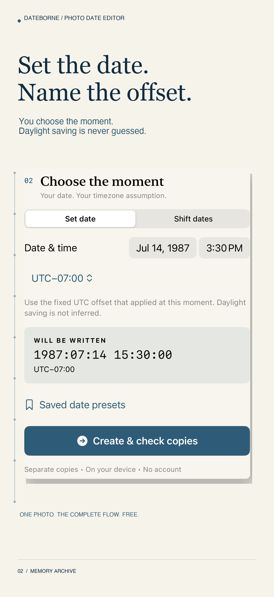
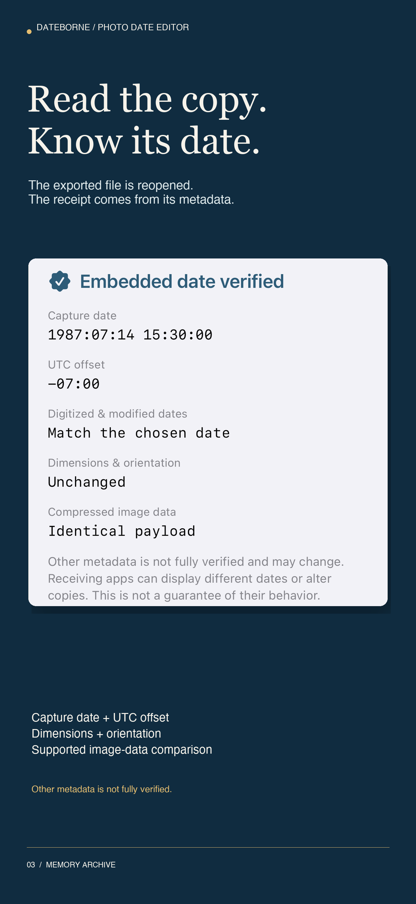

# Dateborne: Photo Date Editor
Give family photos and film scans a moment in time. Set an explicit capture date and UTC offset, export separate JPEG/HEIC copies, and read the written date back before sharing.

**Status: in production.** App Store Connect name reserved October19,2026. Not submitted or released yet. This repository is a source-free product and engineering case study; commercial source is backed up privately.

## The product
A complete single-photo workflow is free. Lifetime Pro adds up to50photos per batch,20saved date/offset presets and an exported verification summary through a one-time purchase. No subscription or account. Native on-device processing for iPhone and iPad, targeting iOS15+.

## Engineering
SwiftUI, native ImageIO container copying, explicit Gregorian/fixed-offset date semantics, Photos/Files selection, additive Photos exports and StoreKit2 verified entitlements. JPEG coding data and supported HEIC HEVC item extents are compared independently from metadata read-back. Output is published only after required date/offset and image-property checks pass. Unknown compressed-data layouts are labeled unverified. No all-metadata or receiving-app date guarantee.

An early native experiment reproduced stale HEIC dates despite a successful write result. The implementation now replaces the mapped date fields and validates output. An independent binary TIFF/EXIF parser verifies fixtures without relying on ImageIO's metadata synthesis. Native QA passed on iPhone SE (iOS 17), iPad 12.9 (iOS 17) and a current iPhone runtime (iOS 26.5). The actual UI saved and reopened copies through Photos and Files, and confirmed embedded date matches. Tests covered 50-photo processing, original preservation, cancellation, preset persistence, large type/Dark Mode/landscape and accessibility contrast/clipping/hit targets. Local Apple StoreKitTest covered transactions and entitlement lifecycle on iOS 17; the iOS 26.5 test service failed and is recorded separately. A distribution-signed Universal archive targets iOS 15 with SDK 26.5. iOS 15 runtime execution, the owner’s real-photo report and genuine Sandbox purchase/restore remain unverified. Apple upload/review work is ongoing.

## Privacy
No backend, external AI, advertising, tracking or content-upload analytics. User-selected images stay local until explicit export. Original photos stay unchanged. Local session files are temporary; optional presets persist locally. Apple manages purchases. [Privacy policy](https://sepidehdalir.github.io/dateborne/privacy.html).

The generated example photograph illustrates the workflow; it contains an intentionally assigned scan date and hypothetical historical date. It is not a customer's photograph.

By **Sepideh Javanbakht Dalir** · [arvinify.com](https://www.arvinify.com) · [hello@arvinify.com](mailto:hello@arvinify.com)

## The campaign

Dedicated iPhone and iPad campaigns use authentic app UI and original generated example artwork. [Product, support and privacy](https://sepidehdalir.github.io/dateborne/).
